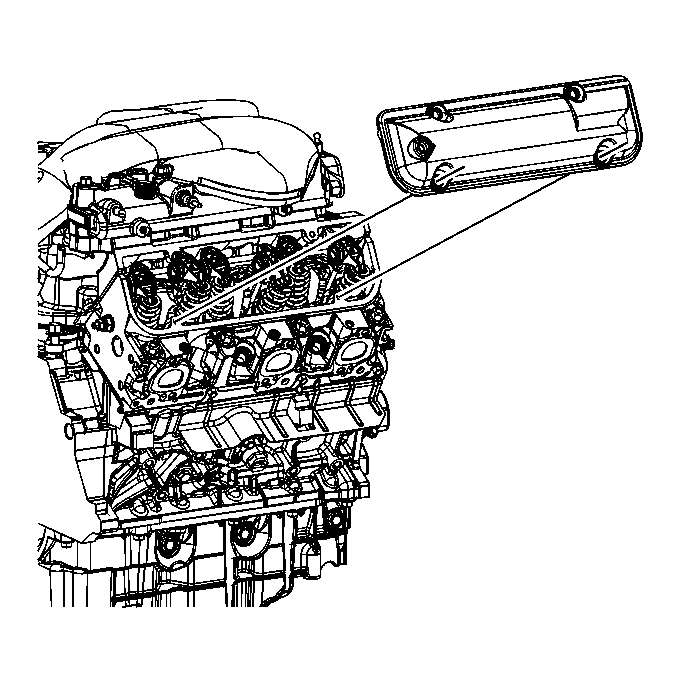
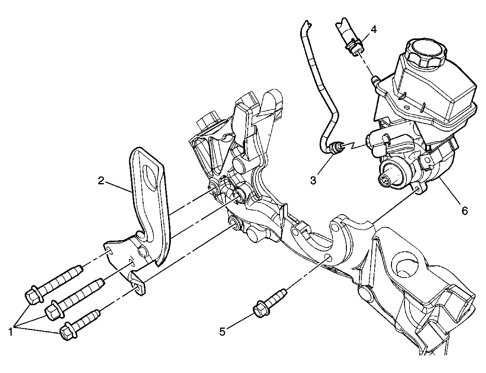
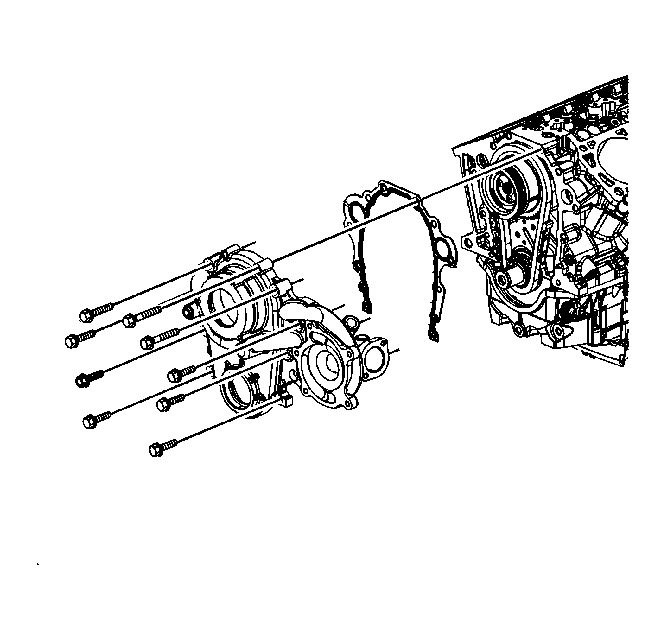

# 🔧 LemonWrench

**A skill for AI coding agents — Claude Code, Hermes, or any harness that reads `SKILL.md`** — that turns a car into a procedure, a torque table, and labelled figures, from free OEM service manuals.

You drop the folder in, and your agent gets a lookup procedure plus a stdlib script for a free service-manual site. Ask it "rear valve cover torque on a 3.9L" and it comes back with the steps, the numbers and the manual's figures. The script runs on its own too if you don't use an agent.

Named for [lemon-manuals.la](https://lemon-manuals.la), the source it scrapes: ~10,000 US/Canada vehicles, 1960–2025, free, no login. Two databases per year — a 2025 capture (`LEMON`) for modern cars and 2013 DVD dumps (`CHARM`) for 90s/2000s, which still carry the finer detail.

> ### 👉 [See the example output — a full job note](examples/2007-pontiac-g6-3.9l-valve-cover-gaskets.md)
> **2007 Pontiac G6 GT 3.9L valve cover gaskets**: both sides step-by-step, a 20-fastener torque table, the blocking bracket identified from a parts catalog, 19 captioned manual figures, and a confidence column that separates what the manual says from what mechanics say — with all 19 of the manual's figures committed alongside it.

```
$ python3 scripts/lemon.py index "Pontiac/2007/G6 V6-3.9L"
indexed /Pontiac/2007/G6%20V6-3.9L/Repair%20and%20Diagnosis/ (2825 KB)
7520 pages indexed -> ~/.cache/lemon/e031f9347485c7e8.idx

$ python3 scripts/lemon.py torque "Pontiac/2007/G6 V6-3.9L" valve cover -p 1
## Valve Rocker Arm Cover Replacement - Left Side
https://lemon-manuals.la/Pontiac/2007/G6%20V6-3.9L/.../Valve%20Rocker%20Arm%20Cover%20Replacement%20-%20Left%20Side/
Tighten the bolts to 10 N.m (89 lb in).
```

## Coverage — 1960 to 2025, 69 makes, ~10,000 vehicles

Your car is almost certainly in here. Domestic, import, dead brands, exotics, work trucks, EVs.

| | |
|---|---|
| **The daily drivers** | Toyota, Honda, Ford, Chevrolet, Nissan-Datsun, Hyundai, Kia, Subaru, Mazda, Volkswagen, Mitsubishi, Chrysler |
| **Trucks & commercial** | Ford, GMC, Chevrolet, Dodge and Ram, Freightliner, International, UD, Workhorse |
| **The orphan brands** (still fully documented) | Pontiac, Oldsmobile, Saturn, Plymouth, Eagle, Geo, Mercury, AMC, Saab, Hummer, Scion, Suzuki, Isuzu, Daewoo, Merkur, Sterling, Checker |
| **Euro & exotic** | BMW, Mercedes Benz, Audi, Porsche, Jaguar, Land Rover, Alfa Romeo, Fiat, Lancia, Peugeot, Renault, Opel, Mini, Volvo, MG, Triumph, Austin |
| **EV & new** | Tesla (2012→), Rivian (2022→), VinFast, Genesis, Smart, ZAP |

Years per make go deep, not just recent: Toyota and Ford cover **66 straight model years (1960–2025)**, Honda from 1969, Pontiac through the 2010 shutdown, Tesla from its first Model S.

Two-minute test for any car:

```bash
python3 scripts/lemon.py cars Ford 1997 | head          # is my year covered?
python3 scripts/lemon.py cars "Dodge and Ram" 2004      # exact trim/engine variants
```

Every hit is tagged `[LEMON]` (2025 capture) or `[CHARM]` (2013 DVDs) — different books, different detail, both free.

## Why it exists

Generic web search gives you a forum thread from 2011 with a broken Photobucket link. The manual gives you the procedure but omits the thing that actually stops the job — the bracket nobody documented that covers one bolt. LemonWrench runs both, plus a parts catalog, and tells you which claim came from where.

**The three-source rule:** manual → parts catalog → field consensus. If they disagree, the note says so instead of picking a favourite.

## What's in the box

| Path | What |
|---|---|
| `SKILL.md` | The agent skill: workflow, answering rules, gotchas, deliverable format |
| `scripts/lemon.py` | Stdlib-only navigator — indexes a vehicle's link tree once, then answers from a local grep |
| `references/repair-writeup.md` | Turning the lookups into a durable note: manual vs field, section order, the confidence column |
| `examples/` | A complete worked note (2007 G6 GT 3.9L valve cover gaskets) **with all 19 manual figures committed** |

## Install

Any agent that loads `SKILL.md`-style skills (Hermes, Claude Code, etc.) — drop the directory in your skills folder:

```bash
git clone https://github.com/bpawnzZ/lemonwrench.git ~/.myagent/skills/lemonwrench
```

Or just use the script directly:

```bash
python3 scripts/lemon.py makes
python3 scripts/lemon.py years Honda
python3 scripts/lemon.py cars Toyota 2015
python3 scripts/lemon.py index "Toyota/2015/Camry LE"
python3 scripts/lemon.py find "Toyota/2015/Camry LE" "fluid capacities"
python3 scripts/lemon.py read "Toyota/2015/Camry LE" "capacity"
python3 scripts/lemon.py torque "Toyota/2015/Camry LE" brake
```

Stdlib only, **Python 3.9+**. No API key, no browser, no dependencies. Cache lives in `~/.cache/lemon/`, so the second question about the same car is instant — the link index and fetched pages both cache (7 days; `LEMON_TTL` seconds overrides, `LEMON_NOCACHE=1` skips, `index --refresh` rebuilds the tree).

## The trick

Fetching a whole manual is slow; the site splits everything into thousands of pages. So index the *link tree* once (~5 MB, cached), then `find` is a local grep and `read` fetches only the winning page — plus, on CHARM, auto-descends the hub pages whose trees are cut off at depth.

```bash
python3 scripts/lemon.py find "Chevrolet/2007/Impala V6-3.9L" generator bracket   # local grep
python3 scripts/lemon.py sub  "https://lemon-manuals.la/.../Alternator/"          # reveal children
python3 scripts/lemon.py get  "https://lemon-manuals.la/.../Service%20and%20Repair/"
```

If the host is slow or down, fetches retry with a backoff and then fail over to a mirror on their own.

## Figures

Manuals are full of exploded views with torque callouts the prose never mentions. `pic` downloads a figure to disk, the agent looks at it, and `note` stores the description permanently — describe a diagram once, and it's text in every later session.

```bash
python3 scripts/lemon.py pic  https://lemon-manuals.la/images25/GM1557668/
python3 scripts/lemon.py note https://lemon-manuals.la/images25/GM1557668/ "right rocker cover: 6-bolt ring, coil bracket above, MAP connector"
```

## Example output

**[examples/2007-pontiac-g6-3.9l-valve-cover-gaskets.md](examples/2007-pontiac-g6-3.9l-valve-cover-gaskets.md)** — a real job note, rendered with its figures: blocking bracket identified, 20-fastener torque table, both sides in order, captioned exploded views, and a confidence column separating what the manual says from what mechanics say.



|  |  |
|---|---|
|  |  |

```bash
cd examples && ./fetch-figures.sh    # re-pull or refresh the figure set
```

## Notes

- Figures ship with the example (19 scans) and can be refreshed anytime with `examples/fetch-figures.sh`.
- Mirrors, if the main host is down: `lemon-manuals.org.ua`, `lemon-manuals.gy`, `lemon.dogeware.me` — used automatically; set `LEMON_BASE` to pin one host instead.
- The skill is source-agnostic in method: swap the manual site and the three-source rule still applies.
- Be a good citizen: the cache exists so one session touches the site a handful of times, not hundreds. Don't disable it to crawl.

MIT.
