---
tags:
  - automotive
  - repair
  - guide
  - pontiac
  - g6
updated: 2026-10-18
vehicle: 2007 Pontiac G6 GT — 3.9L LZ9 V6 (60° pushrod, VVT, FWD)
job: valve rocker arm cover (valve cover) gaskets — both sides
status: in progress — intake off, alternator off, rear cover being attacked
---

# 2007 Pontiac G6 GT 3.9L (LZ9) — Valve Cover Gaskets, Both Sides

> [!note] Figures
> The scans embedded below are the publisher's artwork, so they aren't committed here.
> Run `./fetch-figures.sh` in this folder once to pull all 19 into `figures/`; the note
> then renders in full.

> [!info] Where the job stands
> Intake manifold/cover off, alternator (GM calls it the **generator**) off, down to the **rear (GM "right side") valve cover**.
> Blocker: an alternator-mounted bracket appears to cover a rear valve cover bolt.

> [!tip] Short answer on the bracket
> **It is NOT part of the timing cover.** It is a separate cast bracket that bolts to the right (rear) cylinder head, and the alternator plus the drive-belt idlers hang off it. Nothing internal is behind it — no chain, no oil, no timing reference. Unbolt it, pull it, set it on the bench.

---

## 📋 Contents

1. [Naming: which side is "rear"](#1-naming-which-side-is-rear)
2. [The bracket question, answered properly](#2-the-bracket-question-answered-properly)
3. [How to get that bracket off](#3-how-to-get-that-bracket-off)
4. [Torque table (everything on this job)](#4-torque-table-everything-on-this-job)
5. [Procedure — REAR / right side cover](#5-procedure--rear--right-side-cover)
6. [Procedure — FRONT / left side cover](#6-procedure--front--left-side-cover)
7. [Installation — sealing, RTV, tightening](#7-installation--sealing-rtv-tightening)
8. [Power steering pump — yes, it comes off](#8-power-steering-pump--yes-it-comes-off)
9. [While you're in there](#9-while-youre-in-there)
10. [Manual figures](#10-manual-figures)
11. [Sources / confidence](#11-sources--confidence)

---

## 1. Naming: which side is "rear"

GM service info splits this engine into:

| GM name | What you see | Bank |
|---|---|---|
| **Left side** | Radiator side / front of car — heater pipes, PCV foul-air tube | Bank 2 |
| **Right side** | **Firewall side — the one you're fighting** — generator, coolant crossover, coil pack | Bank 1 |

Every procedure below uses GM's naming. Your "rear valve cover" = **right side**.

---

## 2. The bracket question, answered properly

### Is it part of the timing chain cover?

**No.** Two independent proofs:

1. **GM's Engine Front Cover Replacement (LZ9)** — the timing cover — removes *only*: drive belt tensioner → oil pan → crankshaft balancer → camshaft position actuator magnet → thermostat housing → water pump → then the cover bolts. The alternator and its bracket are never touched. If the bracket were part of the cover, it would appear in that list.
2. **The bracket is a discrete casting** bolted to the right cylinder head. On the 3.5L (LZ4) it is even sold and serviced as its own part — *Generator Bracket* — with its own removal/install procedure. The bracket carries the alternator **and** the drive-belt idler pulleys (and on the 3.5L, the tensioner too). Nothing about it is structural to the timing set.

> [!warning] Don't confuse it with the water pump / front cover
> The water pump bolts to the **front cover** on the opposite end of the engine, and the front cover *is* behind it. That's the other end of the motor. What you're unbolting on the firewall side cannot disturb the chain.

### What GM's own 3.9L G6 procedure says

GM's right-side cover procedure for the **LZ9** lists the generator and the **coolant crossover pipe** as the removal steps — it does *not* explicitly list the generator bracket. In the real world on 3.5/3.9 G6s the cast bracket does block one rear cover bolt, and both G6 owners and dealer techs pull it. So:

- If the cover bolt you can't reach is **under the cast bracket the alternator sat in** → the bracket comes off. That's normal, not a mistake.
- If the obstruction is a **black coil pack on a steel bracket held by 2 bolts + 2 nuts** → that's the *ignition coil bracket*, a different part. Nuts come off, then bolts; it goes back at **25 N·m (18 lb·ft)**.
- If it's a **thin steel stay or lift hook**, that's a lift bracket or a hose support — one or two bolts, note where it went.

---

## 3. How to get that bracket off

**Order of operations** (belt and alternator already off in your case):

1. **Drive belt** — off. (The belt wraps the alternator, so if the alt is out, this is done.)
2. **Generator** — off. Two fasteners only on the LZ9: an upper bolt and a lower **bolt-and-stud**. Terminal nut is 30 N·m (22 lb·ft), the two mounting fasteners are **50 N·m (37 lb·ft)** on reassembly.
3. **Drive belt idler pulley(s)** — off. The LZ9 has **two** idlers, both bolted to this bracket area:
   - idler bolt (1) → **50 N·m (37 lb·ft)**
   - idler bolt (2) → **30 N·m (22 lb·ft)**
4. **Drive belt tensioner** — if it lands on that bracket, one bolt, **50 N·m (37 lb·ft)** on reinstall. (On the LZ9 G6 the tensioner is a single-bolt part; on the 3.5L it lives on the generator bracket along with an idler.)
5. **Bracket bolts** — break them in a cross pattern. Expect **3 bolts**: usually **13 mm** heads with at least one **15 mm** through-bolt, and the low/inboard one is the one you can only get at with a wobble extension or from underneath with the wheel-well splash shield eased back.
6. **Lift the bracket straight off.** It is registered on **dowel pins**, so it will fight you after 19 years of heat cycles. Deadblow or a block of wood + mallet, *never* a pry bar against the machined gasket face. Watch for:
   - a harness clip or a ground strap bolted to the back of it — label it,
   - the bracket hanging up on the coolant crossover pipe studs.

**Going back on:** bracket bolts **50 N·m (37 lb·ft)**, in sequence; then idlers 50 / 30 N·m; tensioner 50 N·m; generator 50 N·m; terminal nut 30 N·m.

> [!note] Practical
> Put the bracket bolts back in their holes in the bracket when you set it down, and take a phone picture of the harness routing before it comes off. Half the "where does this spacer go" threads on these engines start right here.

---

## 4. Torque table (everything on this job)

| Fastener | Spec |
|---|---|
| **Valve rocker arm cover bolts** | **10 N·m (89 lb·in)** — criss-cross, alternating |
| Ignition coil bracket bolts & nuts | 25 N·m (18 lb·ft) |
| Generator upper bolt / lower bolt & stud | 50 N·m (37 lb·ft) |
| Generator battery terminal nut | 30 N·m (22 lb·ft) |
| Generator bracket bolts | 50 N·m (37 lb·ft), in sequence |
| Drive belt tensioner bolt | 50 N·m (37 lb·ft) |
| Idler pulley bolt (1) | 50 N·m (37 lb·ft) |
| Idler pulley bolt (2) | 30 N·m (22 lb·ft) |
| Coolant crossover pipe bolts (1–4) | 50 N·m (37 lb·ft) |
| Radiator surge tank pipe bolts | 10 N·m (89 lb·in) |
| Engine front cover (timing cover) bolts | 25 N·m (18 lb·ft) |
| **Power steering pump bolts (Qty 3)** | **25 N·m (18 lb·ft)** |
| **PS pump pressure line fitting** | **27 N·m (20 lb·ft)** — new O-ring |
| Engine lift bracket bolts (Qty 3) | 50 N·m (37 lb·ft) |

> [!warning] The cover bolts are the whole job
> 10 N·m is **almost nothing** — roughly wrist-tight on a 1/4" ratchet. These thread into aluminum. Over-torquing is the #1 cause of a repeat leak (gasket squashed out of the groove) and the #1 cause of pulled threads. Use a 1/4" drive and an actual torque wrench, criss-cross, two passes.

---

## 5. Procedure — REAR / right side cover

1. **Remove the generator** (see §3; also disconnect the negative battery cable first if not already).
2. **Remove the engine coolant crossover pipe** — it bolts to *both* cylinder heads with **4 bolts at 50 N·m**, and its bosses sit over the inboard edge of the rear cover. GM lists it as a prerequisite on the right side. It is wet — drain/partially drain the cooling system first. Replace the crossover seals/gaskets on reassembly (they are a known leak point on these engines).
   - Crossover removal also wants the **drive belt idler pulleys** and the **power steering pump** out of the way first.
3. **Disconnect the PCV fresh-air tube** from the air cleaner outlet duct, then remove it from the right cover.
4. **Disconnect the MAP sensor connector** (make sure you know which one — the manual calls it out as a distinct connector).
5. **Disconnect the ignition coil electrical connector.**
6. **Remove the HO2S connector clip** from the ignition coil bracket.
7. **Remove the spark plug wires** from the coil.
8. **Remove the ignition coil bracket bolts and nuts**, then lift the coil + bracket off as one unit. (The two nuts often come off **studs that are also valve-cover fasteners** — that's the bolt people think they can't reach.)
9. **Remove the valve rocker arm cover bolts.** Count them out and keep them with the cover.
10. **Break the cover loose** — palm of the hand or a soft rubber mallet on the end of the cover. Do not pry on the gasket rail.
11. **Cut the RTV** in the channel where intake / cylinder head / cover meet. This T-joint is where most of these leak.
12. **Remove the gasket.** GM's note: the gasket is supposed to stay with the head on removal — if it came off with the cover, fine, it's scrap anyway.
13. **Clean the head surface** with degreaser until it's oil-free. The gasket groove in the cover gets the same treatment, plus a pick to get the baked-on RTV out of the T-joint corners.

---

## 6. Procedure — FRONT / left side cover

1. **Partially drain the cooling system.**
2. Remove the intake manifold cover.
3. Remove the air cleaner outlet duct.
4. Disconnect the **left spark plug wires** from the plugs.
5. Remove the **spark plug wire harness clip** from the heater inlet/outlet front pipe bracket.
6. Remove the **heater inlet and outer front pipe**.
7. Disconnect the **PCV foul-air tube** from the PCV valve.
8. Remove the cover bolts.
9. Break the cover loose (palm / soft mallet), cut the RTV at the intake/head/cover joint, remove the gasket, clean the head.

No alternator, no crossover on this side — it's the easy one. Do it **second** if you want the win, first if you want the leak fixed while you're fresh.

---

## 7. Installation — sealing, RTV, tightening

1. **New gasket, every time.** Seat it fully into the groove in the cover — walk the whole perimeter and confirm it isn't twisted or sitting proud anywhere. A gasket that's half-seated leaks worse than the old one.
2. **Sealant at the T-joint.** Apply GM-spec RTV/sealant to the head where the **cylinder head and intake manifold meet** — the corners where the cover, head and intake all converge. The manual defers to *Sealers, Adhesives and Lubricants* for the part number; a black high-torque RTV (Ultra Black / The Right Stuff) is the correct behavior here.
3. **All mating surfaces oil-free.** Degreaser, then dry. Oil on the rail is how a fresh gasket leaks.
4. **Bolts in criss-cross, alternating pattern.** The manual flags this explicitly: wrong sequence = improper gasket seating = oil leak. Two passes: snug everything, then 10 N·m.
5. Reassemble in reverse: coil bracket (25 N·m) → wires/clips/connectors → PCV tube → crossover (50 N·m, new seals) → idlers/tensioner → generator (50 N·m; terminal 30 N·m) → belt → refill and bleed cooling system → negative battery cable.

> [!tip] Belt routing
> Take a photo of the belt routing before it comes off, or use the underhood decal. Two idlers and the tensioner on this drive mean it's easy to get one wrap wrong and eat a belt on first start.

---

## 8. Power steering pump — yes, it comes off

GM lists the PS pump as a prerequisite for the rear cover job (it's required to get the coolant crossover pipe off), and on the LZ9 it sits against that same accessory bracket. Sequence:

1. Syringe/baster the reservoir out first.
2. Belt off.
3. Air cleaner assembly + engine mount strut off (GM preliminaries on this side).
4. **PS pump pulley off** — it is *pressed on*. Use a PS pulley puller/installer set (GM J 25034-C / J 25033-C; parts stores rent the equivalent). Do not pry it, do not hammer it.
5. **3 pump bolts** — 25 N·m (18 lb·ft) going back.
6. Pressure line fitting 27 N·m (20 lb·ft) with a new O-ring; return hose is a clamp.

> [!tip] Keep the hydraulics closed if you can
> If there's enough slack, unbolt the 3 pump bolts and tie the pump up out of the way with the lines still connected. You skip the fluid mess, the new O-ring, and bleeding the system entirely.

> [!note] Watch the names
> The same callout group includes the **engine lift bracket** — 3 bolts, **50 N·m**. If the casting you're staring at has 3 bolts and a lift hook/tab, that may be the lift bracket rather than the alternator bracket. Both are bolt-on, both are separate from the timing cover, and both come off with hand tools.

*Power steering pump assembly (LZ4, LZ9) — 3 bolts, 25 N·m*

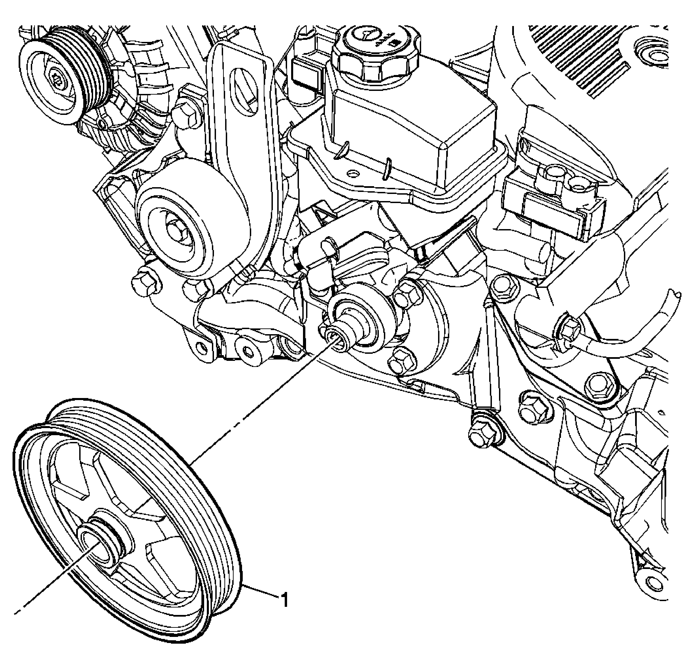

*Power steering pump pulley (LZ4, LZ9) — pressed on, puller required*

---

## 9. While you're in there

- **Check the cover itself** — flatness at the bolt holes, cracks radiating from the bolt bosses, and a grooved/dented gasket rail. A warped cover re-leaks no matter how good the gasket is.
- **Check the bolt grommets/seals** if this engine uses them — hardened, flattened seals stop preloading the cover.
- **Lower intake manifold gaskets** are a classic LZ9 oil/coolant leak and the intake is already off. Same for the **coolant crossover seals** — you're removing it anyway.
- **PCV hoses** — hard, cracked, or oil-sweating hoses get replaced now, not in six months.
- **Clean the coil bracket and check the coil boots/springs** while it's in your hand.

---

## 10. Manual figures

Right (rear) cover + coil bracket:

*View Of Right Valve Rocker Arm Cover*

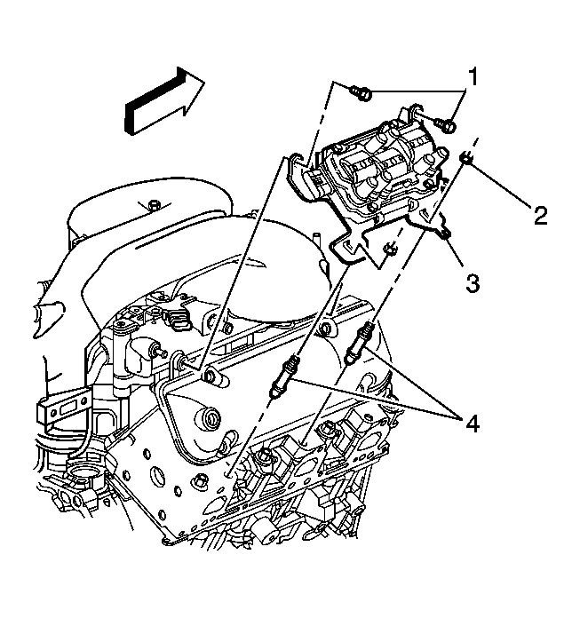

*Identifying Ignition Coil Bracket Bolts & Nuts — bolts (1), nuts (2)*

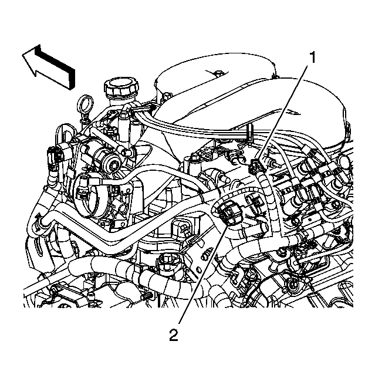

*View Of MAP Sensor Electrical Connector*

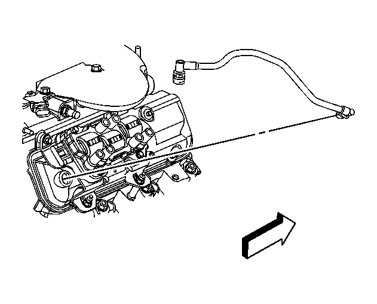

*Identifying PCV Fresh Air Tube*

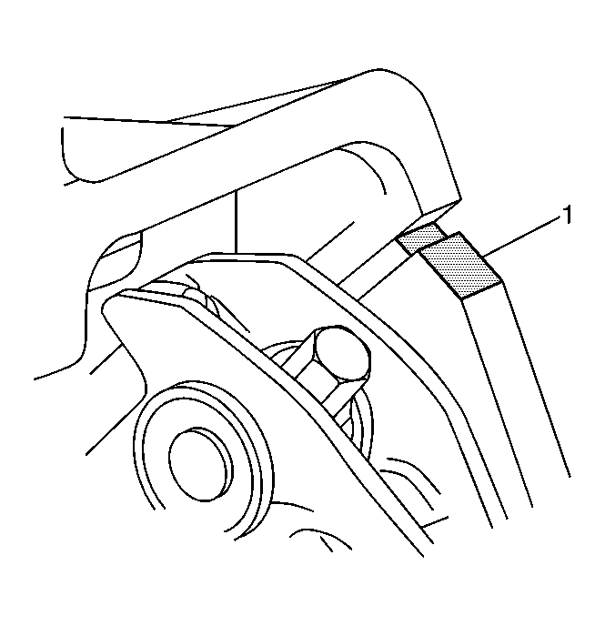

*Identifying Cylinder Head To Lower Intake Manifold Joint — where the RTV goes (1)*

Left (front) cover:

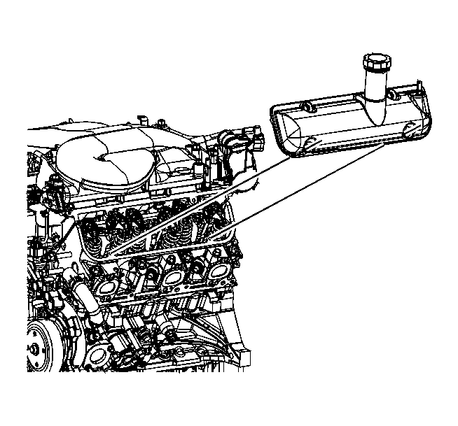

*Identifying Left Valve Rocker Arm Cover*

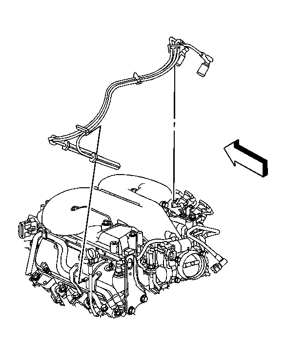

*View Of Left Spark Plug/Coil Harness*

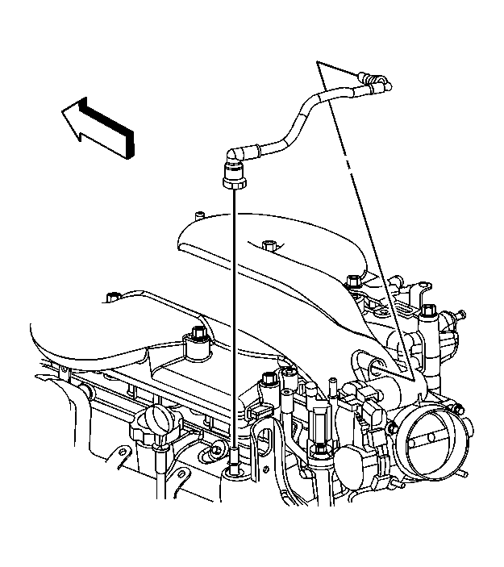

*Identifying PCV Foul Air Tube*

Generator + bracket:

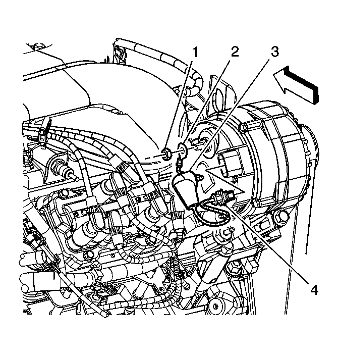

*View Of Generator*

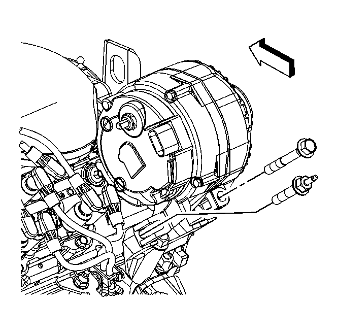

*Identifying Generator Lower Bolt & Stud*

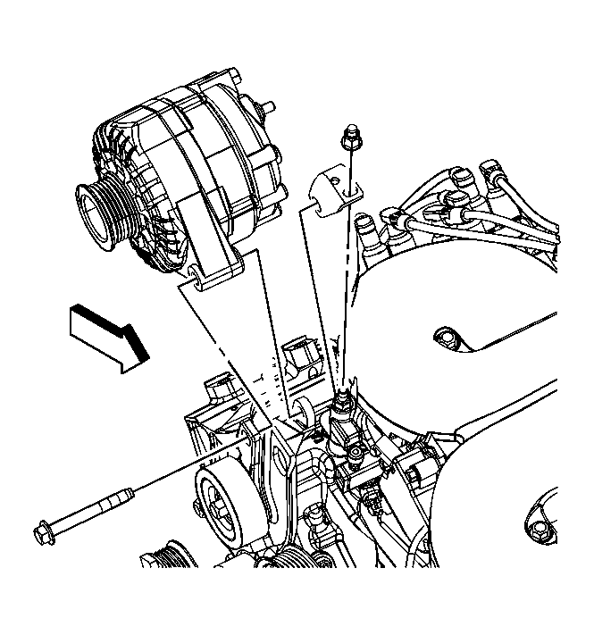

*Identifying Generator Upper Bolt*

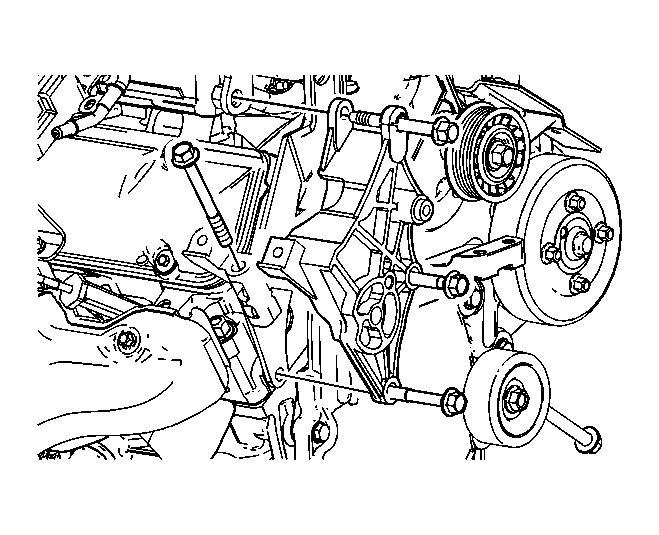

*Removing Generator Bracket Bolts (3.5L LZ4 procedure — same bracket family)*

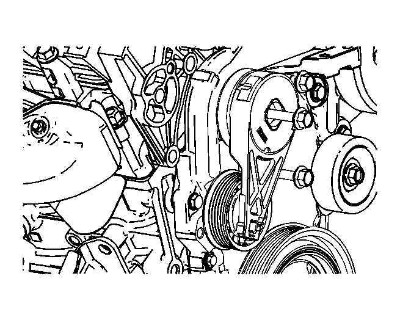

*Removing Drive Belt Tensioner Bolt (LZ4)*

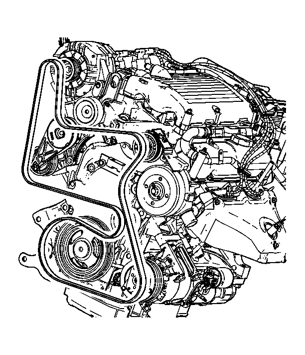

*Removing Drive Belt (LZ4)*

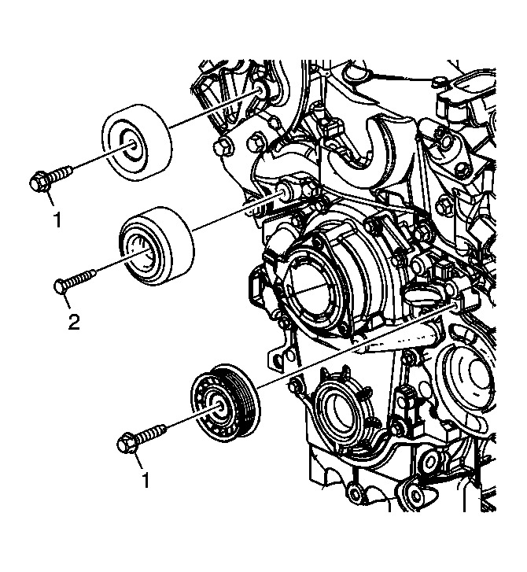

*Identifying Idler Pulley Bolts & Pulleys (3.9L — bolts 1 and 2)*

Coolant crossover + timing cover:

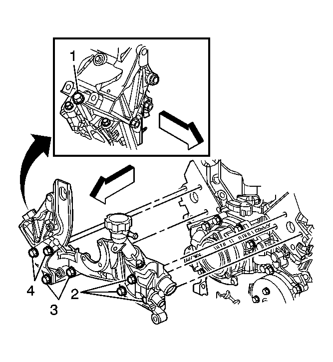

*Identifying Coolant Crossover Pipe Bolts (1–4) — 50 N·m*

*Identifying Engine Front Cover, Bolts & Gasket — the actual timing cover, other end of the engine*

---

## 11. Sources / confidence

| Claim | Source | Confidence |
|---|---|---|
| Cover bolts 10 N·m, criss-cross, RTV at intake/head joint | GM service info: *Valve Rocker Arm Cover Replacement — Left/Right Side* (2007 G6, LZ9) | ✅ verified |
| Right side requires generator + coolant crossover removal | Same, LZ9 right-side procedure | ✅ verified |
| Coil bracket 25 N·m; generator 50 N·m / terminal 30 N·m | Same + *Generator Replacement (LZ9)* | ✅ verified |
| Generator bracket is a separate bolt-on casting, bolts 50 N·m; tensioner + idler bolt to it | *Generator Bracket Replacement (LZ4)* — G6, documented as its own part | ✅ verified (3.5L; 3.9L bracket not listed separately by GM but is the same design family) |
| Crossover bolts 50 N·m, surge tank pipe 10 N·m | *Engine Coolant Crossover Pipe Replacement (LZ9)* | ✅ verified |
| Front cover = timing cover, 25 N·m, removed with tensioner/pan/balancer/magnet/thermostat/water pump | *Engine Front Cover Replacement (LZ9)* | ✅ verified |
| Idlers 50 N·m / 30 N·m on the 3.9L | *Drive Belt Idler Pulley Replacement (LZ9)* | ✅ verified |
| Bracket *must* come off for the rear cover on 3.5/3.9 G6 in practice | G6 owners forum (3.5L rear cover thread), JustAnswer G6 3.5L + Impala 3.9L threads, dealer-mechanic replies | ⚠️ field consensus, not in the G6 3.9L text |
| Valve cover gasket, right side P/N | GM parts listings: **10154775** (position: Right) | ⚠️ confirm by VIN for left side |
| PS pump: 3 bolts 25 N·m, pressure fitting 27 N·m new O-ring, pressed-on pulley (J 25034-C / J 25033-C), prelims = intake cover, belt, idler, air cleaner, engine mount strut | *Power Steering Pump Replacement (LZ4, LZ9)* + *PS Pump Pulley Replacement (LZ4, LZ9)* | ✅ verified |
| Engine lift bracket — 3 bolts, 50 N·m, same callout group as the pump | Same page, callout table | ✅ verified |
| Timing cover is P/N **19209125** (gasket 12604474 included); right cover 12591710 | GM parts catalog, balancer/front diagram | ✅ verified |

**Manual source:** lemon-manuals.la — 2007 Pontiac G6, 3.9L (CHARM database, GM SI capture) and the 2007 G6 GT 4D Sedan 3.9L LEMON/Mitchell entry.

**Not verified:** the exact bolt count/size on *your* bracket (GM lists 3 on the 3.5L pattern; the 3.9L bracket isn't broken out separately in the G6 text), and whether your car needs the crossover fully out or can be nudged aside — check it against the cover's inboard edge before committing.
