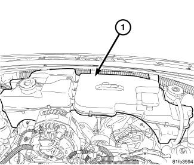
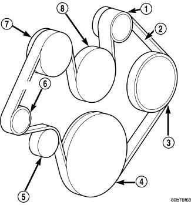
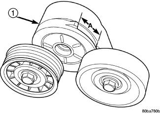
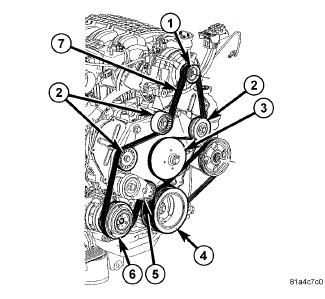

---
tags:
  - automotive
  - repair
  - guide
  - dodge
  - nitro
updated: 2026-10-27
vehicle: 2011 Dodge Nitro — 3.7L V6 (EKG), also covers 4.0L V6
job: accessory / serpentine drive belt — removal, installation, torque specs, figures
status: reference — procedure written from the manual, not yet performed on the vehicle
---

# 2011 Dodge Nitro 3.7L — Serpentine Drive Belt Replacement

> [!info] Status
> Reference procedure built from the Chrysler service information (LEMON 2025 capture) plus a
> parts cross-check. Written for the **3.7L V6** — that's the engine in the overwhelming majority
> of Nitros. The **4.0L** differs only in the tensioner (it takes a square-drive ratchet) and is
> covered in its own section at the bottom.
> Confirmed against the manual for the `Nitro SXT, 3.7 K, 4WD` variant; **RWD uses the same
> accessory drive** (no separate manual entry for the belt differs).

> [!tip] One line
> One 6-rib serpentine belt, one tensioner you rotate with a bar, and one plastic
> coolant/washer reservoir that has to come out of the way first. Nothing gets drained, nothing
> gets unbolted from the drive itself. Budget 30 minutes if the reservoir screws cooperate.

## Contents

1. [What you're buying](#1-what-youre-buying)
2. [Before you start](#2-before-you-start)
3. [Step 1 — move the coolant/washer reservoir](#step-1--move-the-coolantwasher-reservoir)
4. [Step 2 — release tension and remove the belt (3.7L)](#step-2--release-tension-and-remove-the-belt-37l)
5. [Step 3 — install the new belt (3.7L)](#step-3--install-the-new-belt-37l)
6. [Step 4 — check the tensioner wear indicator](#step-4--check-the-tensioner-wear-indicator)
7. [Step 5 — put it back together](#step-5--put-it-back-together)
8. [Torque table](#torque-table)
9. [Figures](#figures)
10. [4.0L V6 — differences](#40l-v6--differences)
11. [Sources / confidence](#sources--confidence)

## 1. What you're buying

| Spec | Value |
|---|---|
| Type | Single serpentine, **6 ribs** (K-section) |
| Effective length | **88.3 in / 2243 mm** (top width ≈ 0.81–0.84 in) |
| Mopar / OE | **53013905AE** (supersedes …AD) |
| Gates | **6K882AP** |
| Dayco (premium) | **5060883** |
| Tensioner assembly (if worn) | Mopar **53013874AC** — fits 2007–2011 Nitro |
| Tensioner pulley bolt | reuse unless chewed; spec'd separately (see torque table) |

One belt drives everything: crank → idler → tensioner → A/C compressor → water pump →
generator → power-steering pump. There is **no separate A/C belt** on this engine — if a counter
hands you two belts for a Nitro, they're selling you the 4.0L or guessing.

## 2. Before you start

- **Negative battery cable off.** The manual's first step, both for the belt and for the reservoir.
- **Engine cold.** You are reaching past the fan and the fan shroud.
- Tools: 3/8" drive ratchet + breaker bar, 10 mm / 13 mm sockets and a short extension, a flat
  blade or trim tool for the washer-pump hoses, and a light. Nothing special is called out — the
  manual lists **no special tools** for this belt.
- **Photograph the routing before the old belt comes off.** Six accessories and one idler make a
  single wrap error easy, and the wrap error that matters is the water pump.
- Nothing is drained. The coolant/washer reservoir is a non-pressurised plastic tank on this
  engine; it comes off with its hoses attached and gets tied aside.

## Step 1 — move the coolant/washer reservoir

Manual: *"Remove combination washer reservoir/coolant recovery container"* (BOTTLE, COOLANT
RECOVERY, REMOVAL). It sits directly in front of the drive on the 3.7L and you cannot get a bar
onto the tensioner with it in place.

1. Reservoir assembly is **item 1** in the figure below.
2. Disconnect the **two washer pump hoses**, the **coolant recovery hose**, and the **washer pump
   electrical connector**.
3. Remove the fasteners **across the upper support** and **on the lower outside edges**
   (one each side).
4. Lift the assembly out and set it aside — it has no drain plug, so keep it upright.

## Step 2 — release tension and remove the belt (3.7L)

1. Put a breaker bar / long ratchet into the **square hole in the tensioner arm** and rotate the
   tensioner **until it contacts its stop**. There is no fastener to remove — the tensioner is
   spring-loaded and pivots.
2. Slip the belt off, then **slowly** rotate the tensioner back toward the freearm position.
3. Catch the belt before it hits the fan.

> [!warning] Do not let the tensioner snap back
> The manual's caution is explicit: *"Do not let the tensioner arm snap back to the freearm
> position, severe damage may occur to the tensioner."* Walk it back by hand under bar control.
> A tensioner slammed to the freearm stop is the single most common way this job turns into a
> tensioner replacement.

## Step 3 — install the new belt (3.7L)

1. **Check the condition of all pulleys first** — spin the idler and tensioner pulley, feel for
   roughness or a dry bearing, look for a glazed or rusty pulley face.
2. Route the new belt around **all pulleys except the idler pulley** (item 5 in Fig 2 below).
3. Rotate the tensioner arm until it **contacts its stop** again.
4. Route the belt around the **idler**, then **slowly** let the tensioner rotate into the belt.
5. Confirm the belt is seated on all pulleys — every rib in every groove, belt sitting flat, no
   rib riding the edge of a pulley.

> [!warning] Routing is not optional
> The manual's caution: *"When installing the accessory drive belt, the belt MUST be routed
> correctly. If not, the engine may overheat due to the water pump rotating in the wrong
> direction."* The water pump is **back-driven** on this drive — a belt wrapped on the wrong side
> of it spins the pump backwards and the engine overheats with a perfectly good belt fitted.
> Check your routing against Fig 2 before you button anything up.

## Step 4 — check the tensioner wear indicator

With the belt installed and tensioned:

- On the **3.7L**, measure the gap between the **tang** and the **housing stop** — dimension **A**
  in Fig 3.
- **Must not exceed 24 mm (0.94 in).** Past that, the tensioner spring is tired — replace the
  assembly (torques in the table below) rather than fitting a second belt to a slack tensioner.

## Step 5 — put it back together

1. Refit the combination coolant/washer reservoir: fasteners across the upper support and the
   lower outside edges, then the two washer pump hoses, the coolant recovery hose, and the washer
   pump connector.
2. Reconnect the **negative battery cable**.
3. Start it, let it idle, and watch the belt for a minute: no chirp, no walk, and the A/C
   compressor clutch should cycle normally. Shut it down, re-check the wear indicator gap A if you
   want a second data point.

## Torque table

Every fastener this job touches, exactly as printed in the service data (N·m / ft·lb / in·lb).

| Fastener | N·m | ft·lb | in·lb | Source |
|---|---|---|---|---|
| **Automatic belt tensioner to mounting bracket — 3.7L** | **41** | **30** | — | manual (cooling system torque) |
| **Automatic belt tensioner pulley bolt — 3.7L** | **61** | **45** | — | manual |
| Coolant pressure bottle to plenum mounting bolts — 3.7L only | 8.5 | — | 75 | manual |
| Generator mounting bolt, M10 | 54 | 40 | — | manual (3.7L engine torque) |
| Generator mounting bolt, M8 | 28 | — | 250 | manual |
| Crankshaft damper bolt *(if you go that deep — not part of a belt swap)* | 175 | 130 | — | manual |
| Water pump bolts — 3.7L *(see conflict note below)* | 58 **or** 54 | 43 **or** 40 | — | manual, two pages disagree |
| Battery negative cable nut | ≈10 | — | ≈89 | ⚠️ field / general practice — not spec'd in the belt procedure |
| Reservoir upper + lower edge fasteners (plastic into sheet metal) | ≈9 | — | ≈80 | ⚠️ field / general practice — manual lists the fasteners, prints no spec |

> [!warning] Low-torque fasteners
> The reservoir fasteners are **plastic into sheet metal** — 8–9 N·m is "snug plus a nudge". They
> strip at anything approaching wheel-nut effort, and the tank then rattles against the support.
> Same story for the 8.5 N·m bottle bolts into the plenum.

> [!note] Water pump torque conflict — flagged, not resolved
> The 3.7L engine torque table prints **58 N·m (43 ft·lb)**; the cooling-system torque table prints
> **54 N·m (40 ft·lb)** for the same bolts. Not part of the belt job, so it doesn't block you —
> but don't pick one silently when you do get there; use the value from the page you're working
> from and note which.

## Figures

**Fig 2 — 3.7L pulley layout / belt routing** (manual callouts, exact):
1 generator pulley · 2 accessory drive belt · 3 power steering pump pulley · 4 crankshaft pulley ·
5 idler pulley · 6 tensioner · 7 A/C compressor pulley · 8 water pump pulley

**Fig 3 — 3.7L automatic tensioner, wear-indicator dimension A**

**Fig 4 — 4.0L accessory drive** (for reference / the other engine)

## 4.0L V6 — differences

Same job, different tensioner release:

1. Remove the combination coolant recovery/washer reservoir (same procedure as Step 1).
2. **Insert a suitable square-drive ratchet into the square hole on the belt tensioner arm.**
3. Rotate the tensioner **clockwise** to release belt tension, remove the belt.
4. Install: verify routing against Fig 4, rotate the tensioner clockwise, position the belt over
   all pulleys (**make sure all V-grooves make proper contact**), gently release the tensioner.
5. Refit the reservoir.

No wear-indicator gap spec was published for the 4.0L in this manual, and the cooling-system
torque table only lists tensioner bolts for the **3.7L** — so **do not** apply the 41 / 61 N·m
figures to a 4.0L tensioner. Pull the 4.0L-specific page if you're doing that engine.

## Sources / confidence

| Claim | Source | Confidence |
|---|---|---|
| Removal order: battery cable → reservoir → rotate tensioner to stop → belt off → tensioner back to freearm | Chrysler service info, `Belt, Serpentine / Removal / 3.7L Engine` (lemon-manuals.la) | ✅ verified (manual) |
| Tensioner must not be allowed to snap to freearm | same page, printed CAUTION | ✅ verified (manual) |
| Route around all pulleys except idler, then tensioner into belt | `Belt, Serpentine / Installation / 3.7L Engine` | ✅ verified (manual) |
| Wrong routing → water pump spins backwards → overheat | same page, printed CAUTION | ✅ verified (manual) |
| Wear indicator gap A ≤ 24 mm (0.94 in) on 3.7L | same page | ✅ verified (manual) |
| Tensioner-to-bracket 41 N·m (30 ft·lb); tensioner pulley bolt 61 N·m (45 ft·lb); bottle bolts 8.5 N·m (75 in·lb) | `Engine Cooling System / Specifications / Torque` | ✅ verified (manual) |
| Pulley/generator/water-pump/damper torques | `3.7L Engine (Service Information) / Specifications / Torque Specifications` | ✅ verified (manual) |
| Reservoir removal/refit steps (two washer hoses, coolant hose, washer connector, upper + lower edge fasteners) | `Bottle, Coolant Recovery / Removal + Installation / Non-Pressure System` | ✅ verified (manual) |
| Belt = 6-rib, ~88.3 in, Mopar 53013905AE, Gates 6K882AP, Dayco 5060883 | CarParts.com fitment for 2011 Nitro 3.7L (Gates 6K882AP, Dayco 5060883); Mopar parts listing 53013905AE, 87.75 in O/C | ✅ verified (three independent crosses agree on rib count and length) |
| Tensioner assembly 53013874AC fits 2007–2011 Nitro | OEM parts listing | ✅ verified |
| Mopar routing string "Crk, Idler, Tens, Comp, Wp, Alt, Ps" | Mopar parts listing for 53013905 | ✅ verified — matches the manual's pulley order |
| Reservoir fasteners ≈9 N·m; battery nut ≈10 N·m | general practice, **not printed in this manual** | ⚠️ field consensus |
| Water pump bolt torque | 58 N·m in engine table vs 54 N·m in cooling table | ⚠️ **unresolved conflict** — reported, not chosen |
| Idler pulley bolt torque | **not published** in the pages read for this engine | ❌ not verified — don't guess one |

**Not verified:** the 4.0L tensioner torque values; whether the 2011 RWD variant's reservoir
fasteners differ from the 4WD variant's (same part shown, but only the 4WD manual was read).
